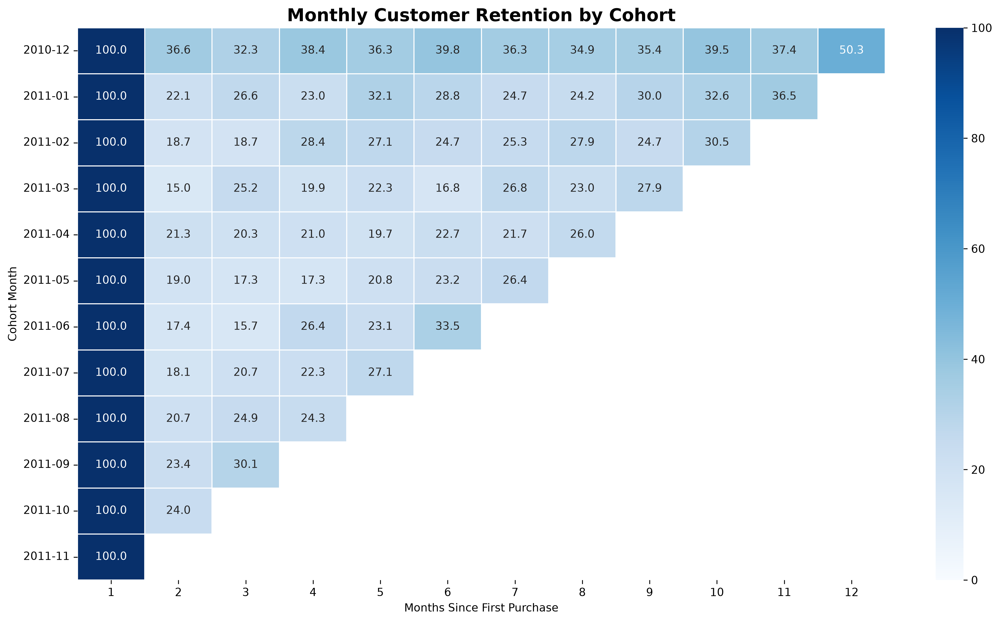
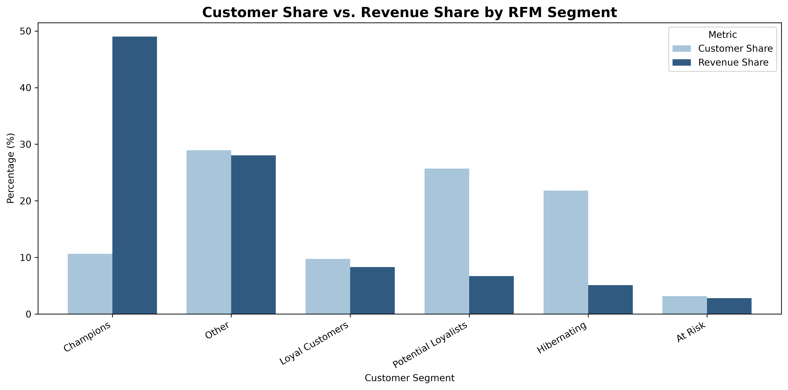

# Beyond the First Purchase
### Customer Loyalty & Retention Analysis Using Python

## Project Overview

This project explores customer purchasing behavior using the UCI Online Retail dataset.

The analysis focuses on understanding repeat purchases, identifying valuable customer segments, and examining customer retention over time.

The goal is to translate transaction data into actionable business insights that can support customer engagement and retention strategies.

## Business Objectives

- Analyze customer purchasing behavior.
- Calculate repeat purchase rates.
- Compare one-time and repeat customers.
- Segment customers using Recency, Frequency, and Monetary (RFM) analysis.
- Measure monthly customer retention through cohort analysis.
- Develop data-driven business recommendations.

## Tools & Technologies

- **Python:** Data analysis and processing
- **Pandas:** Data cleaning and manipulation
- **Matplotlib:** Data visualization
- **Seaborn:** Cohort retention heatmap
- **Jupyter Notebook:** Analysis and documentation

## Key Results

| Metric | Result |
|---|---:|
| Total Customers | 4,338 |
| Repeat Customers | 2,845 |
| One-Time Customers | 1,493 |
| Repeat Purchase Rate | 65.58% |
| Champions | 462 |
| Champions' Share of Recorded Spending | 49.03% |

## Key Findings

**1. Repeat Purchasing Behavior**

Approximately 65.58% of customers made purchases on more than one distinct invoice during the observation period.

**2. High-Value Customers**

Champions represent 10.65% of customers and account for 49.03% of recorded positive purchase spending.

**3. Customer Retention**

Most customer cohorts had second-month retention rates below 25%, highlighting an opportunity to test strategies that encourage customers to return after their first observed purchase.

## Data Visualizations

### 1. Customer Retention by Cohort

The heatmap shows the percentage of customers who returned
to make purchases in subsequent months after their first
observed purchase.



### 2. Customer Share vs. Revenue Share

This chart compares each RFM segment's percentage of
customers with its contribution to total recorded spending.


**4. Customer Segmentation**

RFM analysis identified six customer groups, providing a framework for exploring targeted engagement and retention strategies.


## Business Recommendations

Based on the customer behavior, RFM segmentation, and cohort retention analysis, the following actions are recommended:

### 1. Retain High-Value Customers
Champions account for 49.03% of recorded spending while representing only 10.65% of customers.

**Recommendation:** Test exclusive loyalty benefits and personalized engagement campaigns to encourage continued purchasing among high-value customers.

### 2. Encourage Repeat Purchases
Potential Loyalists represent 25.68% of customers but contribute 6.72% of recorded spending.

**Recommendation:** Test personalized product recommendations and follow-up offers to encourage additional purchases.

### 3. Reactivate Inactive Customers
Hibernating customers represent 21.81% of the customer base.

**Recommendation:** Evaluate targeted reactivation campaigns, prioritizing customers with higher historical spending.

### 4. Improve Early Customer Retention
Most cohorts show second-month retention rates below 25%.

**Recommendation:** Test post-purchase communication and customer engagement strategies to encourage repeat purchases.

### Important Note
These recommendations are based on historical purchasing patterns. Their effectiveness has not been tested and would require further evaluation through controlled experiments.

## Dataset

This project uses the **UCI Online Retail Dataset**, which contains transactional records from a UK-based online retailer.

- **Period:** December 2010 – December 2011
- **Original dataset:** 541,909 transaction line items
- **Customers after cleaning:** 4,338
- **Paid purchase line items after cleaning:** 397,884

### Data Cleaning

The analysis focuses on positive purchase transactions. The following records were excluded:

- Transactions with missing CustomerID values.
- Cancelled invoices identified by an InvoiceNo starting with "C".
- Transactions with non-positive unit prices.

The original dataset is not included in this repository.

## How to Run

1. Download the UCI Online Retail dataset.
2. Save the Excel file as `Online Retail.xlsx` in the same folder as the notebook.
3. Install the required Python packages:

   ```bash
   pip install -r requirements.txt
   ```

4. Open `DATA.ipynb` in Jupyter Notebook or VS Code.
5. Run the notebook cells sequentially to reproduce the analysis.

## Limitations

- **Historical data:** The dataset covers transactions from 2010–2011, so findings may not represent current purchasing behavior.
- **Excluded cancellations and returns:** Spending figures reflect positive purchase transactions rather than net revenue after returns.
- **First observed purchase:** Cohorts are based on each customer's first purchase recorded in the dataset, which may not be their first-ever purchase.
- **Incomplete final month:** December 2011 contains only partial-month data and is excluded from full-month retention comparisons.
- **Rule-based segmentation:** RFM customer groups are based on selected scoring thresholds and classification rules rather than a predictive model.
- **Recommendations not validated:** Suggested business actions have not been tested through experiments.

## Future Improvements

- Build an interactive customer
